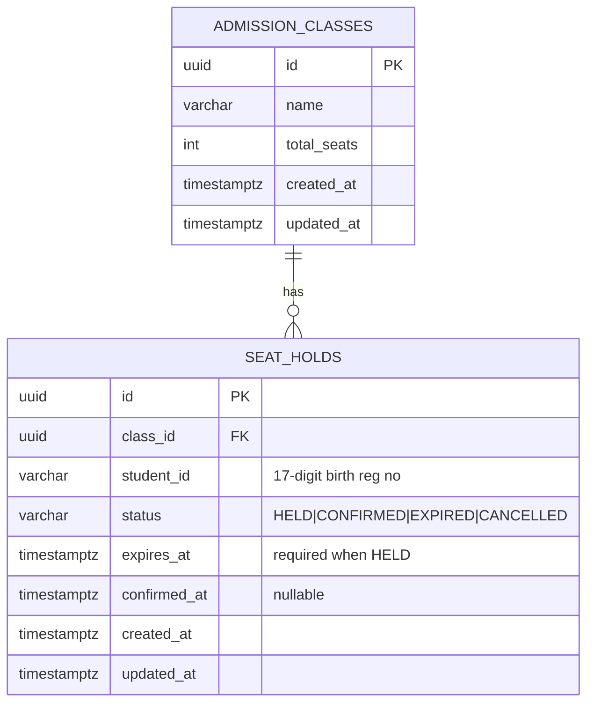
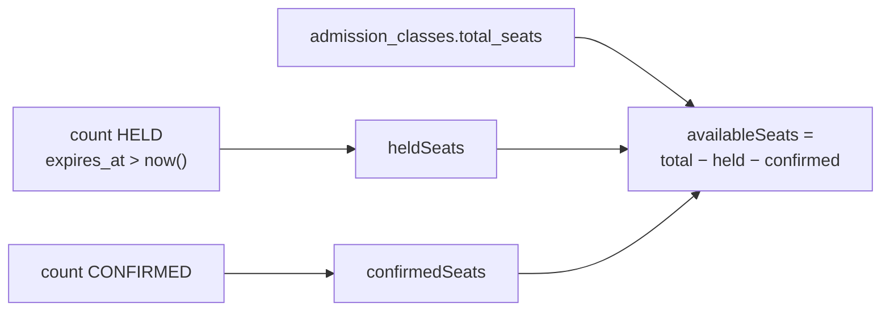
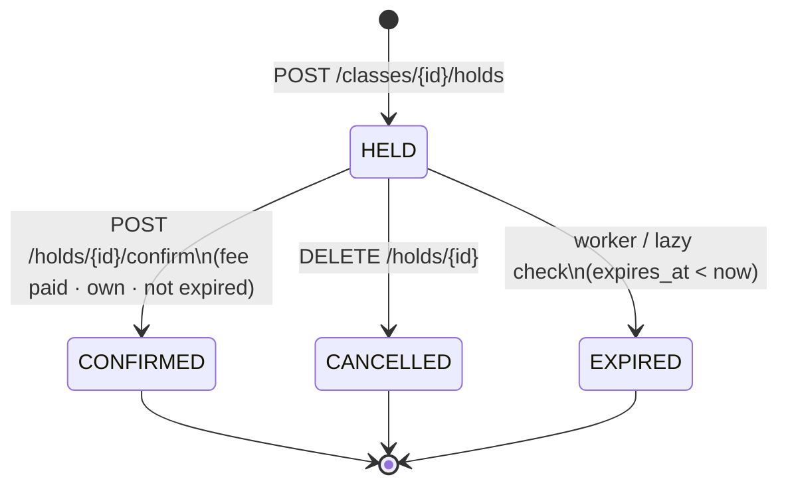
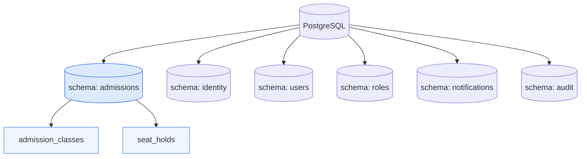

# School Admission — Database Schema Diagram

> Module: `Admissions` · PostgreSQL schema: **`admissions`**  
> Related plan: [`SCHOOL-ADMISSION-APPLY-PLAN.md`](SCHOOL-ADMISSION-APPLY-PLAN.md)

---

## ১) ER Diagram (core)

শুধু **২টা table** লাগে assignment-এর জন্য। Student আলাদা table নয় — `student_id` = ১৭-digit জন্ম নিবন্ধন (`X-Student-Id` header)।



---

## ২) Visual Schema (columns + constraints)

```
┌─────────────────────────────────────────────────────────────────┐
│  PostgreSQL DB                                                  │
│  schema: admissions                                             │
│                                                                 │
│  ┌──────────────────────────────┐                               │
│  │  admission_classes           │                               │
│  ├──────────────────────────────┤                               │
│  │  PK  id              uuid    │                               │
│  │      name            text    │  e.g. "Class 6 - Morning…"    │
│  │      total_seats     int     │  CHECK (total_seats > 0)      │
│  │      created_at      timestamptz                             │
│  │      updated_at      timestamptz                             │
│  └──────────────┬───────────────┘                               │
│                 │ 1                                             │
│                 │                                               │
│                 │ *                                             │
│  ┌──────────────▼───────────────┐                               │
│  │  seat_holds                  │                               │
│  ├──────────────────────────────┤                               │
│  │  PK  id              uuid    │  → API holdId                 │
│  │  FK  class_id        uuid    │  → admission_classes.id       │
│  │      student_id      varchar(17)                             │
│  │      status          varchar │  HELD | CONFIRMED |           │
│  │                              │  EXPIRED | CANCELLED          │
│  │      expires_at      timestamptz NULL                        │
│  │      confirmed_at    timestamptz NULL                        │
│  │      created_at      timestamptz                             │
│  │      updated_at      timestamptz                             │
│  └──────────────────────────────┘                               │
│                                                                 │
│  INDEXES / CONSTRAINTS                                          │
│  • FK: seat_holds.class_id → admission_classes.id               │
│  • INDEX (class_id, status, expires_at)  — seat counting        │
│  • INDEX (student_id)                    — /me/holds            │
│  • PARTIAL UNIQUE:                                              │
│      (student_id, class_id)                                     │
│      WHERE status IN ('HELD', 'CONFIRMED')                      │
│      → এক student এক class-এ একটাই active আবেদন                 │
└─────────────────────────────────────────────────────────────────┘
```

---

## ৩) Seat count কীভাবে বের হবে (derived)

API response fields — DB-এ আলাদা column রাখার দরকার নেই (query-time calculate):



| API field | SQL meaning |
|-----------|-------------|
| `totalSeats` | `admission_classes.total_seats` |
| `heldSeats` | `COUNT(*)` where `status = 'HELD' AND expires_at > now()` |
| `confirmedSeats` | `COUNT(*)` where `status = 'CONFIRMED'` |
| `availableSeats` | `totalSeats - heldSeats - confirmedSeats` |

**Rule:** সবসময় `heldSeats + confirmedSeats ≤ totalSeats`  
(transaction-এ `SELECT … FOR UPDATE` class row-এর উপর)

---

## ৪) Hold status lifecycle



| Status | Seat দখল করে? | Confirm করা যায়? |
|--------|----------------|-------------------|
| `HELD` (অমেয়াদী) | ✅ হ্যাঁ | ✅ হ্যাঁ (নিজের) |
| `HELD` কিন্তু `expires_at` পার | ❌ (EXPIRED ধরো) | ❌ |
| `CONFIRMED` | ✅ হ্যাঁ | idempotent — counter বাড়ে না |
| `EXPIRED` | ❌ | ❌ |
| `CANCELLED` | ❌ | ❌ |

---

## ৫) Module ↔ schema map (পুরো DB)

একই Postgres DB; assignment module নতুন schema পাবে। পুরনো template schemas optional।



| Schema | Module | এই assignment-এ |
|--------|--------|-----------------|
| `admissions` | Admissions | **প্রয়োজনীয়** |
| `identity` / `users` / `roles` / … | পুরনো template | Login লাগে না — optional / trim |

---

## ৬) Suggested SQL (reference)

```sql
CREATE SCHEMA IF NOT EXISTS admissions;

CREATE TABLE admissions.admission_classes (
    id           uuid PRIMARY KEY,
    name         varchar(200) NOT NULL,
    total_seats  int NOT NULL CHECK (total_seats > 0),
    created_at   timestamptz NOT NULL,
    updated_at   timestamptz NOT NULL
);

CREATE TABLE admissions.seat_holds (
    id            uuid PRIMARY KEY,
    class_id      uuid NOT NULL REFERENCES admissions.admission_classes (id),
    student_id    varchar(17) NOT NULL,
    status        varchar(20) NOT NULL,
    expires_at    timestamptz NULL,
    confirmed_at  timestamptz NULL,
    created_at    timestamptz NOT NULL,
    updated_at    timestamptz NOT NULL,
    CONSTRAINT seat_holds_status_check
        CHECK (status IN ('HELD', 'CONFIRMED', 'EXPIRED', 'CANCELLED'))
);

-- Seat counting / expiry queries
CREATE INDEX ix_seat_holds_class_status_expires
    ON admissions.seat_holds (class_id, status, expires_at);

-- My applications
CREATE INDEX ix_seat_holds_student
    ON admissions.seat_holds (student_id);

-- One active application per student per class
CREATE UNIQUE INDEX ux_seat_holds_active_student_class
    ON admissions.seat_holds (student_id, class_id)
    WHERE status IN ('HELD', 'CONFIRMED');
```

> EF Core migration দিয়েই তৈরি করবে — উপরের SQL শুধু mental model।

---

## ৭) API ↔ Table mapping

| API | Table touch |
|-----|-------------|
| `POST /classes` | INSERT `admission_classes` |
| `GET /classes` | SELECT classes + aggregate holds |
| `GET /classes/{id}` | same, one row |
| `POST /classes/{id}/holds` | LOCK class + INSERT `seat_holds` (HELD) |
| `GET /holds/{id}` | SELECT `seat_holds` (+ lazy expire) |
| `POST /holds/{id}/confirm` | UPDATE HELD → CONFIRMED |
| `DELETE /holds/{id}` | UPDATE HELD → CANCELLED |
| `GET /me/holds` | SELECT `seat_holds` by `student_id` + join class name |

---

Cursor / GitHub-এ Mermaid preview চালু থাকলে উপরের diagram গুলো render হবে।  
Plan ফাইল: [`SCHOOL-ADMISSION-APPLY-PLAN.md`](SCHOOL-ADMISSION-APPLY-PLAN.md)
